## 16S Analysis Pipeline
A 16S amplicon pipeline that imports paired-end reads, denoises them into amplicon sequence variants with DADA2, assigns taxonomy against 16S reference database, and runs diversity and differential abundance analyses in QIIME 2.

### Environment / Packages Needed
(refer `env.yml`)
1. **QIIME2** — `q2cli version 2024.10.1`
2. **R** — `R version 4.3.3 (2024-02-29)`

### Guide to Run the Pipeline
1. Locate the files below:
- read files and metadata in a single folder (also serve as output directory)
```
16S_Project
├── read_1.fastq.gz
├── read_n.fastq.qz
└── sample-metadata.tsv
```
- script file
```
16S_Pipeline
├── 16s_lib.sh      # variable and function declarations (DO NOT RUN THIS)
└── 16s.sh          # commands to perform analysis
```

2. In `16s_lib.sh`, provide the following in the RENAME block:
- output directory
- metadata filename
- reference files pathname

3. In `16s.sh`, perform modification to the parameter where necessary, based on the reads file type, denoise settings, taxa level to collapse, sampling depth and metadata column name (refer comments).

4. In terminal, activate virtual environment containing the required packages.
```bash
conda activate <VENV_PATHNAME>
```

5. Then, run any related command below:
```bash
chmod +x <PATH>/16s.sh      # first-time running only

sh 16s.sh                   # show the interactive menu, can direct to below 3 options

sh 16s.sh 6 7               # run selected step(s), regardless
sh 16s.sh all               # run all steps, skipping finished ones
sh 16s.sh allforce          # run all steps, rerun every step regardless
```

### Output Files Structure
Directories with suffix:
- `_a` contain table files `*.qza`
- `img` contain visualization files `*.qzv`

All qiime zipped files can be viewed on [QIIME2 View](https://view.qiime2.org).

```
16S_Project
├── 1_Reads
│   ├── (all read files)
│   └── data.qza                        # demuxed read
│
├── 2_Feature
│   ├── denoising-stats.qza
│   ├── rep_seqs.qza                    # fasta sequences
│   └── table.qza                       # asv table
│
├── 3_taxonomy_a
│   ├── classification.qza              # taxonomy assignment of features
│   ├── search-results.qza
│   ├── table_lvl3.qza                  # taxa collapse to level 3 - class
│   └── table_lvl7.qza                  # taxa collapse to level 7 - species    
│   
├── 4_taxonomyimg
│   ├── feature_heatmap.qzv             # taxa heatmap
│   ├── summary.qzv                     # sample and taxa bar plot
│   └── taxa_barplot.qzv                # interactive bar plot
│
├── 5_diversity_a
│   ├── (all alpha and beta diversities .qza)
│   ├── bray_curtis_pcoa_biplot.qza
│   ├── jaccard_pcoa_biplot.qza
│   └── rel_table_lvl3_.qza
│
├── 6_diversityimg
│   ├── alpha_rarefaction.qzv           # alpha: line chart
│   ├── bray_curtis_emperor.qzv         # beta: 3D scatter plot
│   ├── bray_curtis_emperor_biplot.qzv  # beta: 3D biplot
│   ├── jaccard_emperor.qzv             # beta: 3D scatter plot
│   ├── jaccard_emperor_biplot.qzv      # beta: 3D biplot
│   ├── observed_featuresimgector.qzv    # alpha: box plot
│   └── shannonimgector.qzv              # alpha: box plot
│
├── 7_differential_a
│   ├── comp_table.qza 
│   └── differentials.qza
│
├── 8_differentialimg
│   ├── ancom.qzv                       # ancom volcano plot
│   ├── da_barplot.qzv                  # da bar plot
│   └── da_table.qzv                    # da interactive table
│
├── logs
│   └── pipeline_20261020_140840.log
│
└── sample-metadata.tsv
```

### Visualization Files

Sample data: Sea Water and Pond Water Metagenomics Samples

| Habitat | Samples |
| --- | --- |
| Sea water | A3, E1, E2 |
| Pond water | SE01, SE07, SE09 |

#### 1. Taxonomy Distribution

**`feature_heatmap.qzv`** — hierarchical clustering heatmap showing the relative abundances of microbial features across samples
<p align="center">
    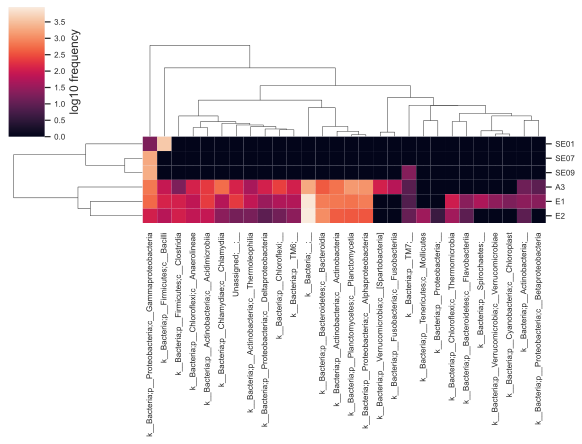
<p>

**`summary.qzv`** — sample frequency and feature frequency in table and bar plot
<p align="center">
    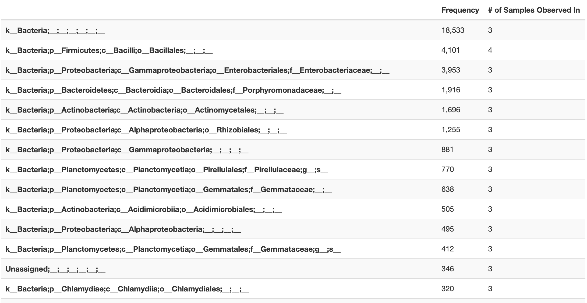
<p>

**`taxa_barplot.qzv`** — taxonomic barplot showing relative abundances of microbial taxa across samples clustered with selected taxonomic level
<p align="center">
    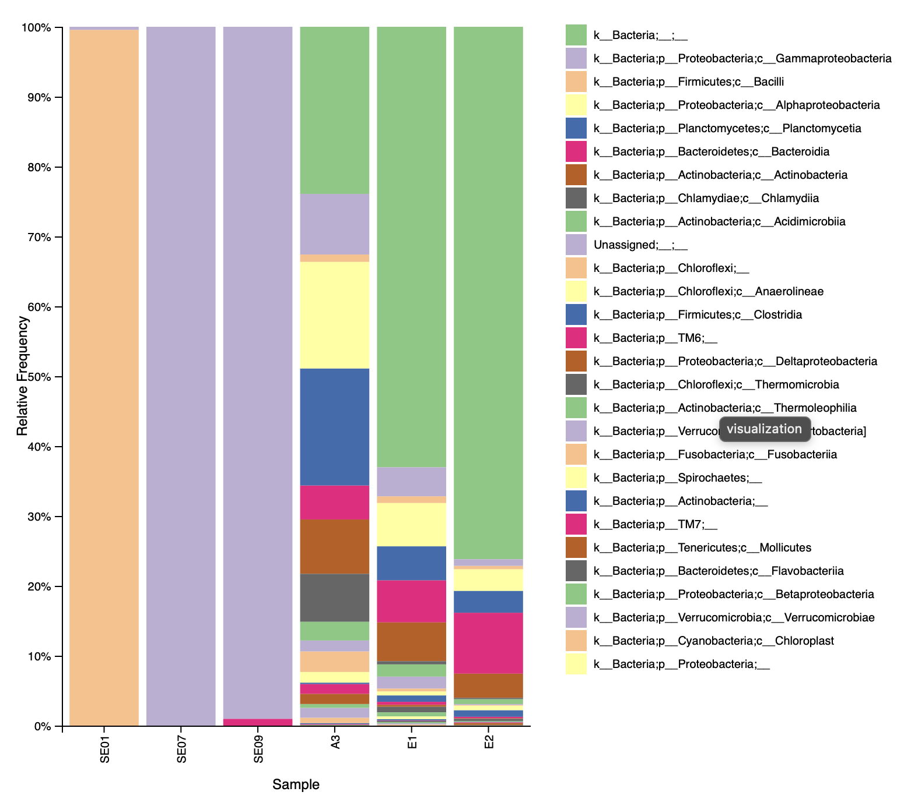
<p>

#### 2. Diversity

**`alpha_rarefaction.qzv`** — alpha rarefaction plot showing estimated species richness against sequencing depth (available in observed features and shannon index) 
<p align="center">
    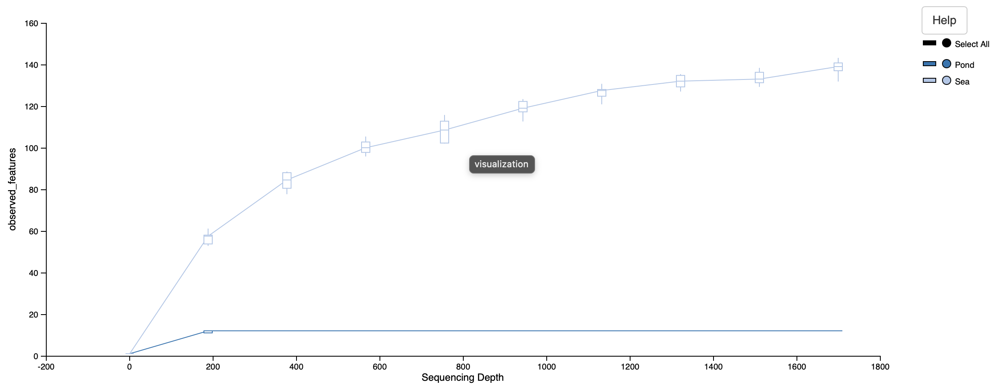
<p>

**`observed_features_vector.qzv` `shannon_vector.qzv`** — alpha diversity boxplot comparing the distribution of alpha diversity across metadata category (habitat)
<p align="center">
    
    
<p>

**`bray_curtis_emperor.qzv` `jaccard_emperor.qzv`** — beta diversity 3D PCoA scatter plot showing similarity / dissimilarity among samples
<p align="center">
    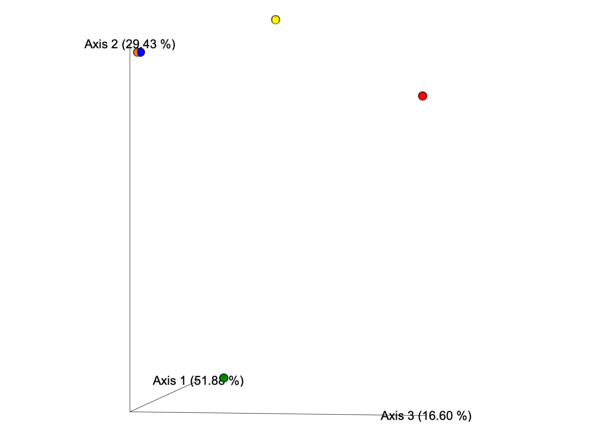
    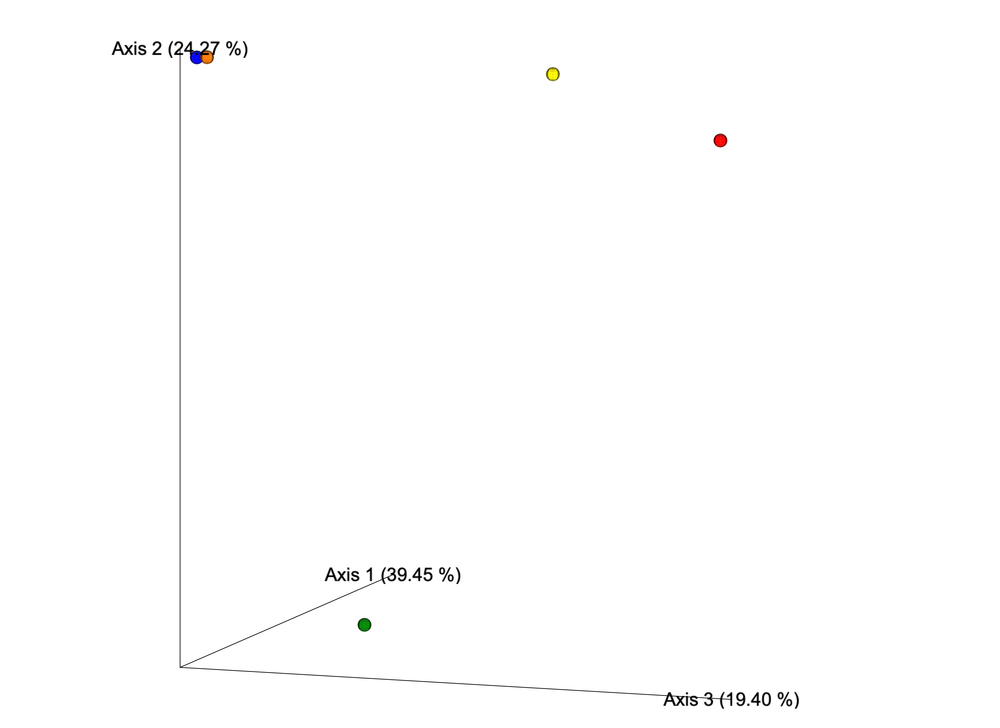
<p>

**`bray_curtis_emperor_biplot.qzv` `jaccard_emperor_biplot.qzv`** — beta diversity 3D PCoA biplot highlighting the specific microbial taxa driving the dissimilarity across samples
<p align="center">
    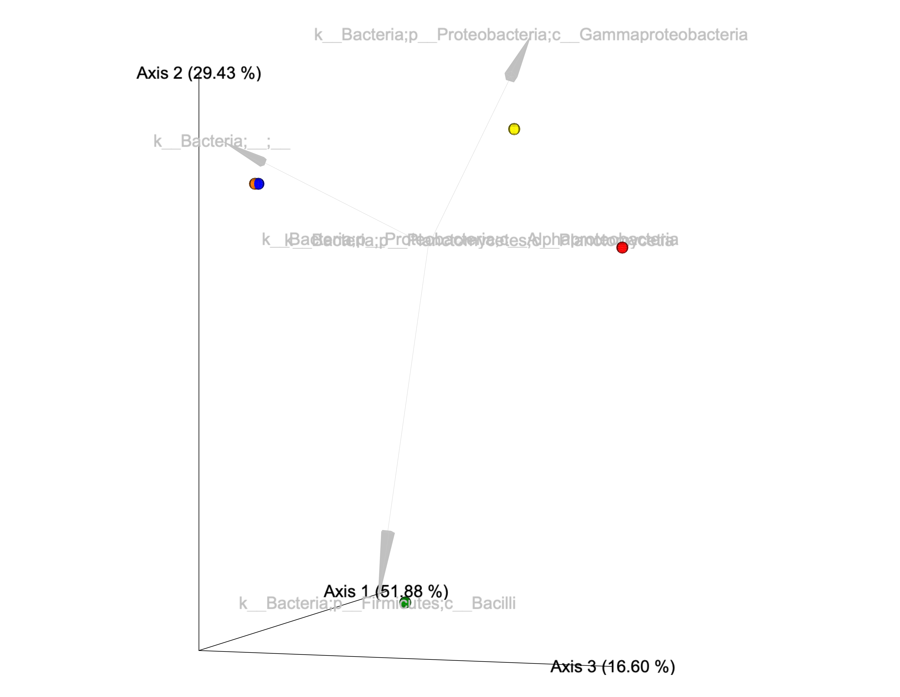
    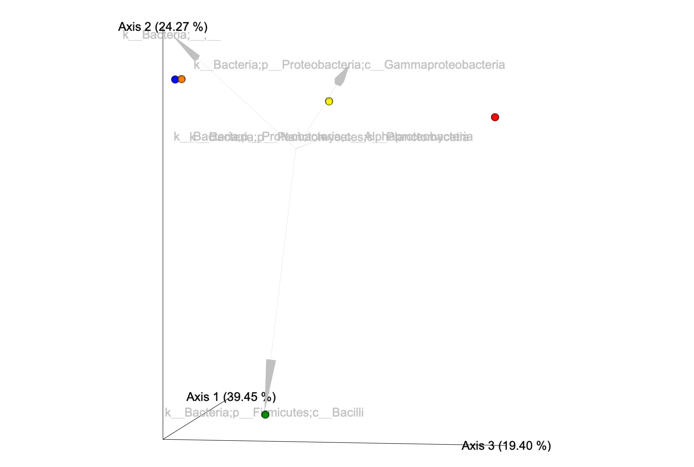
<p>

#### 3. Differential Abundance

**`ancom.qzv`** — ANCOM volcano scatter plot showing w-stats against CLR mean difference to identify significantly changing taxa between samples clustered by metadata category (hover over data point to show the taxa)
<p align="center">
    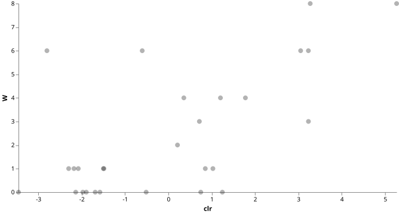
<p>

**`da_barplot.qzv`** — barplot showing estimated LFC of significantly changing taxa between samples clustered by metadata category
<p align="center">
    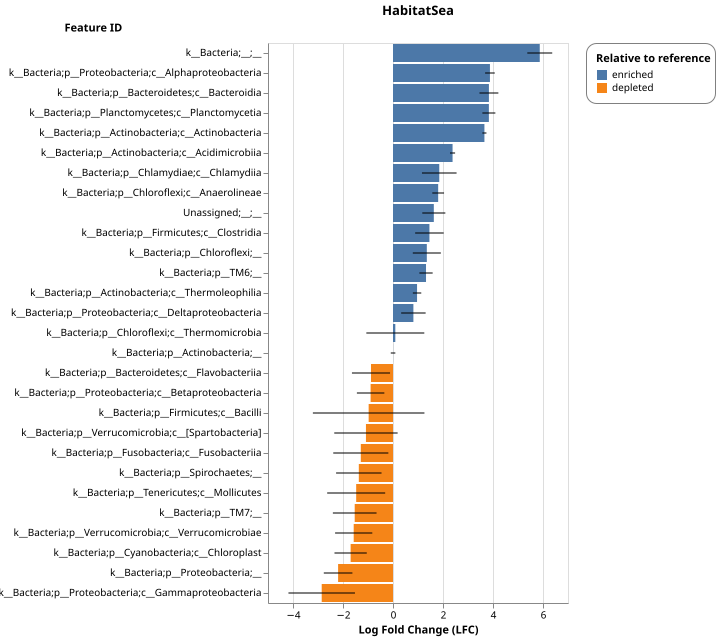
<p>

### Documentation

`16s_lib.sh` function dependencies
<p align="center">
    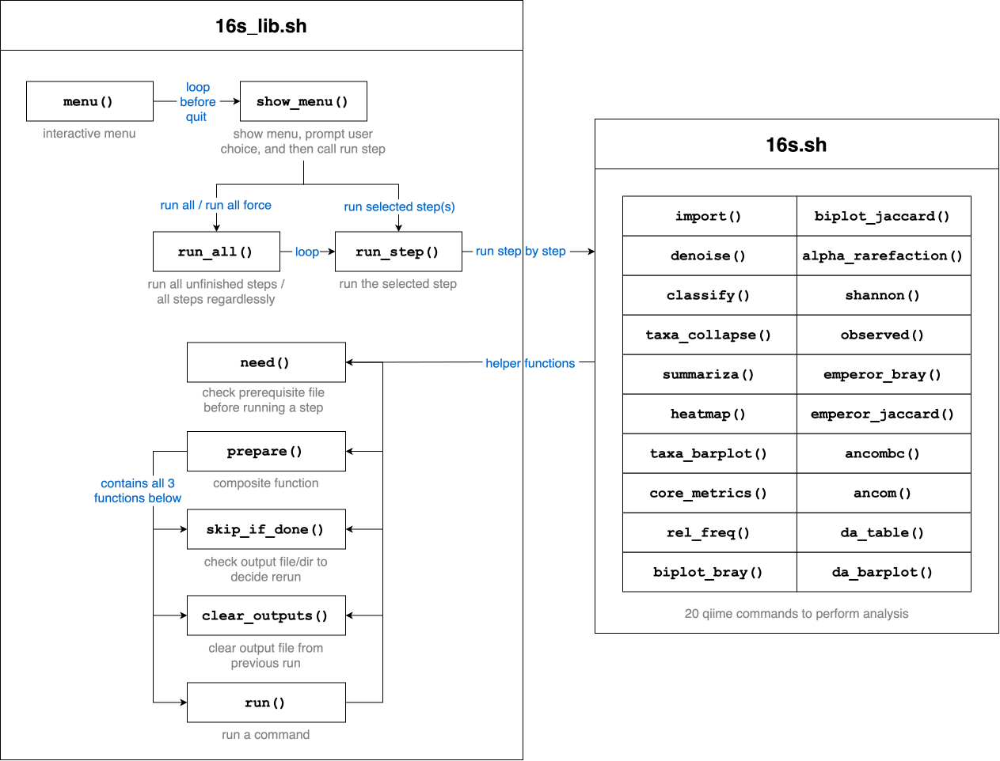
<p>